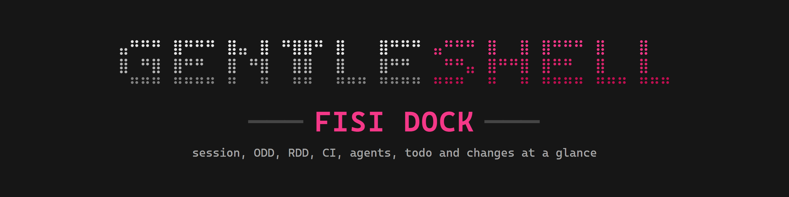
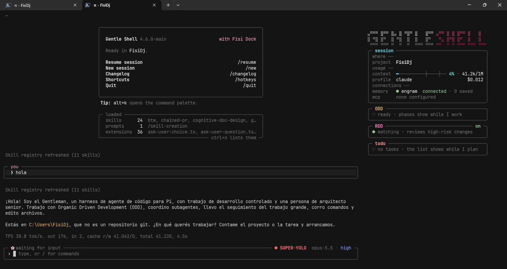
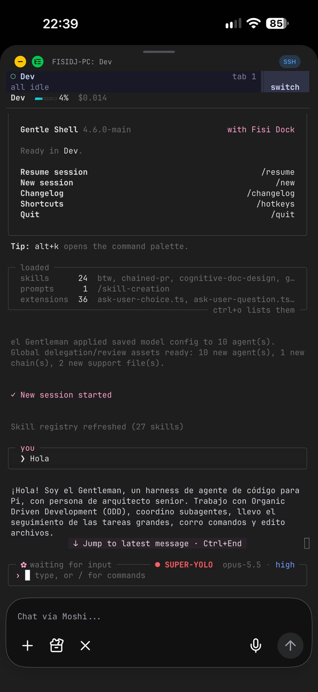

<p align="center"></p>

# Fisi Dock

**A side panel for [Gentle Shell](https://github.com/Gentleman-Programming/gentle-shell): your session, ODD phases, RDD reviews, CI, agents, todo list and changes at a glance.**

Fisi Dock is an alternative look for Gentle Shell, for people who want a different interface from Gentle Shell's default one: a side panel layout with its own colors and its own `Fisi-Dock` themes. It is built on top of Gentle Shell and does not replace it: Gentle Shell stays installed and keeps running underneath, and Fisi Dock only repaints the parts you see.

It is a Pi package (an extension and its themes) that paints its own panel in Gentle Shell's fullscreen right rail, closes the prompt into a framed box, puts a welcome card on the start screen and adds a compact strip and cards on narrow screens such as a phone over SSH. `/fisi-dock settings` makes the look yours: the logo, the frames, the colors (light terminals included), the accent, the divider, the motion and the sections. It never changes a Gentle Shell file, and `/fisi-dock off` gives Gentle Shell everything back.

> Fisi Dock is a community project. It is not an official Gentle Shell or Gentleman Programming project, and it is not endorsed by them.



<p align="center"></p>

<p align="center"><sub>On a desktop terminal with the side rail, and on a phone over SSH.</sub></p>

```text
 ⣤⠛⠛⠛ ⣿⠛⠛ ⣿⣤ ⣿ ⠛⣿⠛ ⣿   ⣿⠛⠛ ⣤⠛⠛ ⣿ ⣿ ⣿⠛⠛ ⣿   ⣿
 ⣿ ⠛⣿ ⣿⠛  ⣿ ⠛⣿  ⣿  ⣿   ⣿⠛   ⠛⣤ ⣿⠛⣿ ⣿⠛  ⣿   ⣿
  ⠛⠛⠛ ⠛⠛⠛ ⠛  ⠛  ⠛  ⠛⠛⠛ ⠛⠛⠛ ⠛⠛  ⠛ ⠛ ⠛⠛⠛ ⠛⠛⠛ ⠛⠛⠛
╭─ session ───────────────────────────────────╮
│ project  my-sample-app  main ↑1             │
│ context  ━─────────┼────┼── 6% · 12.1k/200k │
│ profile  claude                      $0.012 │
│ mcp      ● engram    connected              │
│          ✗ context7  failed                 │
│          ◌ github    connecting             │
╰─────────────────────────────────────────────╯
╭─ ODD ───────────────────────────────────────╮
│ ✓ exploring                            0:31 │
│ ✓ implementing                         1:12 │
│ ✓ exploring                            0:20 │
│▎⡿ checking                             0:42 │
╰─────────────────────────────────────────────╯
╭─ RDD ────────────────────────────────── on ─╮
│ ✓ fisi-dock.md approved               23:05 │
│▎⠹ lib/orbs.ts +2 reviewing…            0:18 │
╰─────────────────────────────────────────────╯
╭─ agents ────────────────────────────────────╮
│ ✓ explore Map CI workflow                   │
│ ⠹ verify Check PR 265 checks                │
│ ⠹ writer pin the Node version   opus · high │
╰─────────────────────────────────────────────╯
╭─ todo ──────────────────────────────── 3/7 ─╮
│ ✓ 3 done                            ▰▰▰▱▱▱▱ │
│▎⠹ Confirm CI is green                       │
│ ○ Commit workflow fix                       │
│   +2 more                         /dock all │
╰─────────────────────────────────────────────╯
```

(Sample data, from `node scripts/preview.ts 47 --rows 34`, in the default look. In the terminal every section title has its own color, each frame fades from a soft gray at the middle of its edges into the background at the corners, and in the rail a thin divider line runs between the chat and the panel, brightest halfway down. The desktop screenshot above predates this look: it still shows flat frames and the session's group labels. To change the look, see [Look](#look).)

## What you get

- **Side panel** in the fullscreen rail, one framed section each, under the GENTLESHELL logo, with a fading divider line between the chat and the panel: `session` (project and branch, context meter, model profile and cost, Engram memory and MCP servers, and the skills Pi loaded, in that order; `/skills` or `ctrl+s` unfolds their names), `heads-up` (worktrees, unpushed commits, open plans), `ODD`, `RDD`, `CI` (GitHub Actions of the branch), `agents`, `todo` and `changes`. On short screens the least urgent rows and sections step aside first.
- **Your own look**: `/fisi-dock settings` picks the rail logo, the section frames, the colors (`vivid`, `soft` or `light`), the accent, the divider, the motion and the sections shown and their order, with a live preview ([Look](#look)).
- **Start screen**: a welcome card in place of Gentle Shell's rose banner (Gentle Shell's version, the project and branch, the commands to begin with), and Pi's list of loaded skills, prompts and extensions folded into one `loaded` box under it. Your expand key (`ctrl+o` by default) shows Pi's full listing; Pi's warnings always show.
- **Prompt box**: Gentle Shell's prompt framed like the panel's sections, with the working label (`ODD exploring…`), the permission mode, the model and the effort on its top border. Your messages get the same frame.
- **Narrow screens and phones**: a one-line top row, a strip above the prompt, and compact agents and todo cards.
- **`/dock`**, **`/skills`** (or `ctrl+s`) and **`/fisi-dock`**: the whole panel over the screen, the loaded skills unfolded in the panel, and an on/off switch that needs no uninstall ([Commands](#commands)).
- **Eleven themes**: `Fisi-Dock` and its soft, light and accent variants carry the panel's hues to the whole of Pi. The one for your look is applied once on the first start, with your own theme remembered for `/fisi-dock off` ([Theme](#theme)).

Every section, row and data source is described in [docs/reference.md](docs/reference.md).

## Adapts to your setup

| Your setup | What Fisi Dock does |
|---|---|
| Narrow screen or phone | The strip, cards and top row stand in for the rail. On the prompt box the labels compact step by step instead of vanishing: tight separators, then no effort, then the mode alone (the model alone in normal mode). Idle, the label's words give way first so the labels stay. Under 34 columns the welcome card keeps only its title and ready lines. |
| Gentle Shell in another language | The idle prompt label is told by how Gentle Shell paints it, not by its words, so a translated or custom label behaves the same. |
| No Engram | The `memory` row says `not installed`. With Engram, a failed `mem_*` call shows `unreachable` until the next one succeeds. Fisi Dock starts no process and asks no server. |
| No MCP servers | The `mcp` row says `none configured`. |
| Many MCP servers | The rail shows at most 4 `mcp` rows: problems first, then `+N more` with a count per state. `/dock` lists every server. |
| Remapped expand key | The `loaded` box names your key, from Pi's editor or Pi's `keybindings.json`; a key bound to nothing drops the hint. |
| Vim mode on | Gentle Shell's `INSERT`/`NORMAL` hint stays on the prompt's top rule and the labels compact to make room for it. With no room for both, the hint wins while working and the labels win while idle. |
| Reduced motion | Gentle Shell's `potato` animation level, or `FISI_DOCK_ORBS=off`, stills the orb and spinners. |
| No Gentle Shell | Fisi Dock stays out of the way: no rail, strip, cards, prompt box or welcome card, and Pi keeps its own startup header and listing. `/dock` still opens the panel. |

## Requirements

- **Gentle Shell** (the `gentle-pi` npm package). Fisi Dock is tested with **Gentle Shell 4.7.0**. It reads Gentle Shell's shared state by name and imports nothing from it, so on another version a part it no longer recognizes stops painting instead of breaking the session.
- **Node.js 22.19 or later** (the one Gentle Shell runs on).
- **Fullscreen mode** for the side panel, with a terminal at least 140 columns wide; narrower terminals get the strip, the cards and `/dock`.
- Optional: **`git`** for branch, changes and heads-up; **GitHub CLI (`gh`)**, signed in, for the `CI` section; **Gentle AI** for the `RDD` switch; **gentle-engram** (Gentle Shell's Engram package) for a connected `memory` row; MCP servers in Pi's `mcp.json` for the `mcp` rows. A missing tool only leaves its section out or says so in its row.

Works on Windows, macOS and Linux.

## Install

Install it into Gentle Shell from GitHub, so it loads every time Gentle Shell starts:

```bash
gentle-shell install git:github.com/fisidj/fisi-dock
```

Without a tag you follow the `main` branch. Releases are tagged `vX.Y.Z` and listed on the [Releases page](https://github.com/fisidj/fisi-dock/releases); the latest is `v0.4.0`. To pin one, add `@<tag>` to the source: `gentle-shell install git:github.com/fisidj/fisi-dock@v0.4.0`. Pi keeps a pinned tag: updates do not move it.

Fisi Dock is also on npm: `gentle-shell install npm:fisi-dock`, pinned with `npm:fisi-dock@0.4.1`.

If you run Gentle Shell with `--link` (Pi's own home instead of the launcher's isolated one), install it there instead: `gentle-shell --link install git:github.com/fisidj/fisi-dock`.

Try it for one session without installing:

```bash
gentle-shell -e git:github.com/fisidj/fisi-dock
```

Then start Gentle Shell as usual. The panel, prompt box and welcome card are on from the first session in the default look, and that first session switches Pi to the `Fisi-Dock` theme once, remembering yours: see [Theme](#theme) to keep your own.

As with any Pi package, Fisi Dock runs code on your machine: review the source before installing it.

## Commands

Fisi Dock adds three commands:

| Command | What it does |
|---|---|
| `/dock` | Shows the full panel over the whole screen, live. Made for narrow screens without the side rail; works on wide ones too. While Fisi Dock is off it only says so. |
| `/skills` or `ctrl+s` | Unfolds the `skills` row at the end of the panel's session section: the names of the skills Pi loaded, grouped by where they come from (package, user, project). `/dock` adds one row per skill with what it does. `/skills` or `ctrl+s` again folds it. While Fisi Dock is off it only says so. |
| `/fisi-dock on` | Turns Fisi Dock back on, as at the start of a session, and switches Pi to Fisi Dock's theme for your colors and accent (`Fisi-Dock` by default, see [Theme](#theme)), remembering the theme you had. Already on: it says so and changes nothing. |
| `/fisi-dock off` | Puts Fisi Dock to sleep without uninstalling it: Gentle Shell gets its own panel back, and your theme comes back (see [Theme](#theme)). New sessions start asleep until `/fisi-dock on`. |
| `/fisi-dock settings` | Opens the look menu, with the rail drawn under it as a live preview: see [Look](#look) for its settings and keys. Works while Fisi Dock is off too. |
| `/fisi-dock` | Opens a picker titled with the current state (`Fisi Dock is on`), the change listed first, then `settings`: Enter picks, Esc changes nothing. Typing `/fisi-dock ` with the space suggests `on`, `off` and `settings`; any other argument shows the usage and changes nothing. |

Inside `/dock`:

| Key | Action |
|---|---|
| ↑ / ↓ | Scroll one row |
| Page Up / Page Down | Scroll one page |
| Mouse wheel, or a finger swipe on a phone terminal that sends swipes as the wheel | Scroll |
| Esc | Close and return to the prompt |

Gentle Shell and Pi controls that change what Fisi Dock shows:

| Control | Effect on Fisi Dock |
|---|---|
| `/settings` → **Theme** | Picks any theme, Fisi Dock's eleven included ([Theme](#theme)). |
| Your expand key (`ctrl+o` by default) | Shows Pi's full list of loaded skills, prompts and extensions in place of the `loaded` box; press it again for the box. |
| `/gentle:vim disable` | Turns Gentle Shell's Vim mode off, and with it the `INSERT`/`NORMAL` hint on the prompt box. `/gentle:vim enable` turns it back on. |
| `"quietStartup": true` in Pi's `settings.json` | Pi prints no loaded-resources listing, so there is no `loaded` box. |

## Look

`/fisi-dock settings` opens the look menu over the whole screen, with the rail drawn under it as a live preview. The defaults are the look drawn at the top of this page, so nothing changes until you pick something.

| Setting | Default | Other values |
|---|---|---|
| `logo` | `braille`: the GENTLESHELL wordmark in braille dots | `text`: one bold `GENTLESHELL` row · `none`: no logo, the panel starts at its first section |
| `frames` | `faded`: boxes whose edges fade toward the corners | `classic`: the flat gray boxes of 0.3.1 · `none`: no box, each title on a fading rule, a blank row between sections |
| `colors` | `vivid`: the vivid titles and labels of 0.3.x | `soft`: the pastel tones from before 0.3.0 · `light`: for a light terminal background |
| `accent` | `pink`: Fisi Dock's pink | `teal` · `lilac` · `amber` · `green` |
| `divider` | `medium`: the fading line between the chat and the rail | `off`: no line, its column stays blank so the panel does not move · `subtle`: dimmer · `strong`: brighter |
| `motion` | `on`: spinners, the ODD orb, the prompt label wave and petal, and new rows' entrance move | `off`: all of them stand still on one frame and new rows appear at once |
| `sections` | `7 of 7`: every section, in today's order | Hide or reorder `heads-up`, `odd`, `rdd`, `ci`, `agents`, `todo` and `changes` |

What each one reaches:

- **`frames`** covers the rail, `/dock`, the prompt box and your messages. With `none`, the prompt box and your messages keep only their top line, as a fading rule with the same labels.
- **`colors`** `light` repaints everything Fisi Dock paints (the rail, `/dock`, the cards and strip, the prompt box, your messages, the top row, the welcome card, the `loaded` box, the menu) with dark text, frames fading toward the light background and every color reading at least 4.5:1. The terminal's background stays yours.
- **`accent`** replaces Fisi Dock's own pink: the highlight bar `▎` and the active todo spinner, `you` on your messages, the prompt label wave and petal, the SHELL half of the logo and the menu. Each section keeps its own color (session teal, ODD amber, agents lilac, changes green…), and the permission mode stays red.
- **`motion`** `off` keeps every state's glyph (`✓`, `●`, `◌`, `✗`, `!`), so nothing rests on motion alone.
- **`sections`**: a hidden section is not drawn on the rail or in `/dock`, even when it has something to show, and the order applies to both. `session` is always shown and first.

Inside `/fisi-dock settings`:

| Key | Action |
|---|---|
| ↑ / ↓ (or k / j) | Move between `logo`, `frames`, `colors`, `accent`, `divider`, `motion` and `sections` |
| ← / → (or h / l), Enter | The previous or next value. On `sections`, → or Enter opens the sections list |
| Esc (or q) | Close and return to the prompt |

Inside the sections list (each section `[x]` shown or `[ ]` hidden):

| Key | Action |
|---|---|
| ↑ / ↓ (or k / j) | Move between the sections |
| Space | Show or hide the selected section |
| Shift+↑ / Shift+↓ (or K / J) | Move the selected section up or down |
| Esc, q or ← (or h) | Back to the settings |

Each change applies at once to the preview, the rail, `/dock`, the cards, the prompt box and your messages. The look is remembered across sessions and across `/fisi-dock off` and `on`. Changing `colors` or `accent` also switches Pi's theme when the menu closes, see [Theme](#theme). Details: [docs/reference.md](docs/reference.md#look-settings).

## Theme

Fisi Dock ships eleven Pi themes, one per look: `Fisi-Dock` (`vivid`) and `Fisi-Dock-Soft` (`soft`); for another accent, `Fisi-Dock-Teal`, `Fisi-Dock-Lilac`, `Fisi-Dock-Amber` and `Fisi-Dock-Green`, each with its `-Soft` pair (`Fisi-Dock-Teal-Soft`, …); and `Fisi-Dock-Light` for `light` colors, whatever the accent. They color the whole of Pi, not only the panel, and they are optional: the panel keeps its own colors with any theme. None of them is ever remembered as your theme. Fisi Dock switches between them only while one of them is in use: with a theme of your own picked in `/settings`, the menu changes Fisi Dock's colors and leaves your theme alone.

**Vivid labels.** With `vivid` colors, the labels wear the vividness of the cover title `#F43888`, each on its own hue: the theme's accents (pink, deep pink, teal, coral, amber, lilac, green, blue, red), the panel's section titles and the counters on their top rule (`3/7`, `on`), and the labels Fisi Dock paints on the prompt box (`● SUPER-YOLO`, the effort, the `ODD exploring…` wave). Each color keeps its hue at HSL saturation 90% and lightness 59%, lighter where a hue would read under 4.5:1 on the `#161616` background (blue, lilac). The frames, the rows inside the sections, gray labels (the model, `1 to commit`), the neutrals and the backgrounds keep their colors.

**The first start applies it once.** The first session with Fisi Dock on, inside Gentle Shell, remembers the theme you use, then switches Pi to the theme of your look (`Fisi-Dock` by default) and says so: `Fisi Dock applied its theme · /fisi-dock off puts your theme dark back`. This happens once, also on an install from before this step; every later start leaves your theme alone. It waits for the next start when Pi does not know that theme or cannot set it, and it never changes your theme when Fisi Dock cannot save the one you had. It never runs in a delegated subagent session, and a Fisi Dock that is off does nothing at start: `/fisi-dock on` sets the theme instead.

| How | What happens |
|---|---|
| The first start | Once, as above. Your theme is remembered for `/fisi-dock off`. |
| `/fisi-dock off`, then `/fisi-dock on` | On remembers the theme in use and sets the theme of your look (`/fisi-dock on` while already on changes nothing). |
| `/fisi-dock settings` → `colors` or `accent` | Switches to the theme of the new look when the menu closes, while one of Fisi Dock's themes is in use. Nothing new is remembered. |
| `/settings` → **Theme** → `Fisi-Dock` | Pi switches now and saves it as your theme setting. Nothing new is remembered, so a later `/fisi-dock off` gives back the theme remembered before, else Gentle Shell's `Gentleman-Cute`. |

To keep your own theme after the first start, or to switch back:

- `/settings` → **Theme**, and pick any theme, Gentle Shell's `Gentleman-Cute` included: the panel stays on and later starts keep that theme; or
- `/fisi-dock off`: it puts back the remembered theme (the one you had at the first start or at your last `/fisi-dock on`), else `Gentleman-Cute`, and puts the panel to sleep too. A remembered theme Pi no longer knows is skipped, and off says so.

Both `/fisi-dock` and `/settings` go through Pi's own theme setting, so the change lasts across restarts.

## Turn it off, disable or remove

Three levels, from lightest to complete:

| Goal | How | Back on |
|---|---|---|
| Turn it off for now, keep it installed | `/fisi-dock off` inside Gentle Shell. Remembered across restarts. | `/fisi-dock on` |
| Disable the package, keep it installed | `gentle-shell config`: Pi's picker of the resources every installed package loads; turn off Fisi Dock's extension (and its themes, if you like). Applies on the next start. | `gentle-shell config` again |
| Uninstall | `gentle-shell remove git:github.com/fisidj/fisi-dock` (`uninstall` is the same command) | `gentle-shell install git:github.com/fisidj/fisi-dock` |

If you installed with `--link`, put it before the subcommand: `gentle-shell --link config`, `gentle-shell --link remove git:github.com/fisidj/fisi-dock`.

**What you get back**, in all three cases: Gentle Shell's own panel (its rail sections, top row and status bar), its prompt editor in place of the box, Pi's own startup header and loaded-resources listing, and Gentle Shell's rose banner (on the next start or `/reload` after `/fisi-dock off`).

**Your theme** comes back only with `/fisi-dock off`. `gentle-shell config` and `remove` leave Pi's theme setting as it is. If that setting is one of Fisi Dock's themes when they are no longer loaded, Pi falls back to its `system` theme without a warning. So run `/fisi-dock off` first, or pick a theme in `/settings` afterwards.

**What stays**: the state file `fisi-dock/state.json` in Pi's agent dir (`PI_CODING_AGENT_DIR`, which Gentle Shell sets to its home: `~/.gentle-shell/agent/fisi-dock/state.json` by default, `~/.pi/agent/fisi-dock/state.json` with `--link`). It holds only the on/off choice, the remembered theme, whether the first start already applied the theme and your [look](#look), for example `{ "enabled": false, "theme": "dark", "themeApplied": true, "look": { "logo": "braille", "frames": "faded", "colors": "vivid", "accent": "pink", "divider": "medium", "motion": "on", "sections": [{ "id": "heads-up", "shown": true }, …] } }`. Removing Fisi Dock does not delete it, and it is safe to delete: without it Fisi Dock starts on with the default look, remembers no theme and applies its theme again on the next start.

## Update

```bash
gentle-shell update git:github.com/fisidj/fisi-dock
```

`gentle-shell update <source>` runs Pi's update for that one package: without a tag it moves to the latest `main`; pinned to a tag it stays on that tag. To move to another release, run `gentle-shell install` again with the new tag; Pi replaces the entry. `gentle-shell update --extensions` updates every installed package at once (`gentle-shell update` alone updates Pi itself).

## How it works

Fisi Dock takes over, and paints its own:

- Gentle Shell's rail parts and top row, through Gentle Shell's shared sidebar state;
- Gentle Shell's prompt editor frame, by wrapping its editor factory;
- Pi's startup header (the welcome card, through `ctx.ui.setHeader`) and the render of Pi's loaded-resources listing (the `loaded` box), only while Gentle Shell's `gentle:banner` command exists.

It reads the rest from Gentle Shell's events, its ODD phase and profile registries, Pi's session and tool list, and read-only `git`, `gh` and `gentle-ai` calls. The files it reads:

| File | For |
|---|---|
| Pi's `mcp.json` (global and the project's `.pi/mcp.json`) | the `mcp` rows; only server names and their on/off switch |
| Pi's `keybindings.json` | the expand key on the `loaded` box |
| Gentle Shell's `config.json` beside its agent home (`~/.gentle-shell/config.json` by default) | the version on the welcome card |
| Gentle Shell's `animations.json` | the animation level |
| Gentle Shell's subagent presence file | subagents already running after a `/reload` |
| The project's `odd/tasks/*.md` | open ODD plans in `heads-up` |

It writes only its own `state.json` and your Pi theme setting: once on the first start, when `/fisi-dock` switches it on or off, and when `/fisi-dock settings` changes the colors or the accent while one of Fisi Dock's themes is in use. When it unloads, or with `/fisi-dock off`, Gentle Shell and Pi get every original part back. Details: [docs/reference.md](docs/reference.md).

## Develop

```bash
git clone https://github.com/fisidj/fisi-dock
cd fisi-dock
npm ci
npm test
```

Tests run on Node 22.19 or later with native TypeScript; no build step. They need the dev dependencies (Pi's real TUI classes and its source), so run `npm ci` first, as CI does. `tests/configs.test.ts` drives Fisi Dock through simulated user configurations (another language, no Engram, ten MCP servers, Vim, a 30-column screen, a remapped or unbound expand key, no Gentle Shell) and checks every surface at every width from 0 to 140, against a fresh temp folder, never your own configuration. `tests/gentle-shell-keys.test.ts` also checks the installed Gentle Shell (`GENTLE_SHELL_DIR`, else the `gentle-pi` package Gentle Shell itself runs, found from its session environment or its `gentle-shell` launcher on `PATH`, pnpm or npm, else `gentle-pi` in the global npm root; among several, the version provisioned in `~/.gentle-shell/config.json`) still defines every key Fisi Dock reads, and is skipped without it.

Preview the panel with sample data in a terminal (width defaults to 47, the rail's usable width), or write an HTML page for screenshots:

```bash
node scripts/preview.ts 47
node scripts/preview.ts --html tmp/panel-47.html
node scripts/preview.ts 64 --strip
node scripts/preview.ts --dock
node scripts/preview.ts 64 --header
node scripts/preview.ts 58 --rows 28
```

`--strip` prints the narrow-screen strip, `--dock` the `/dock` box, `--header` the narrow top row, and `--rows <n>` the panel as it fits a terminal `<n>` rows tall. `tmp/` is git-ignored.

Time what the panel costs while it runs (a rail draw, a `/dock` draw, a store update on a spinner tick), with no terminal and no Pi:

```bash
npm run bench
npm run bench -- --save tmp/bench.json
```

It prints the median and p95 time per call for each case, in about ten seconds; `--save <file>` also writes the numbers as JSON, to compare a change against the run before it.

The accent themes and `Fisi-Dock-Light` are generated from `themes/Fisi-Dock.json` and `themes/Fisi-Dock-Soft.json`, never edited by hand: after changing either source, run `npm run build:themes`. A test checks the shipped files are its output.

## Contributing

Issues and pull requests are welcome: [CONTRIBUTING.md](CONTRIBUTING.md) covers what makes a good bug report, the test and docs rules, and how to try a checkout in Gentle Shell. Report a vulnerability privately, as [SECURITY.md](SECURITY.md) describes. Everyone taking part follows the [Code of Conduct](CODE_OF_CONDUCT.md).

## License

[MIT](LICENSE)
